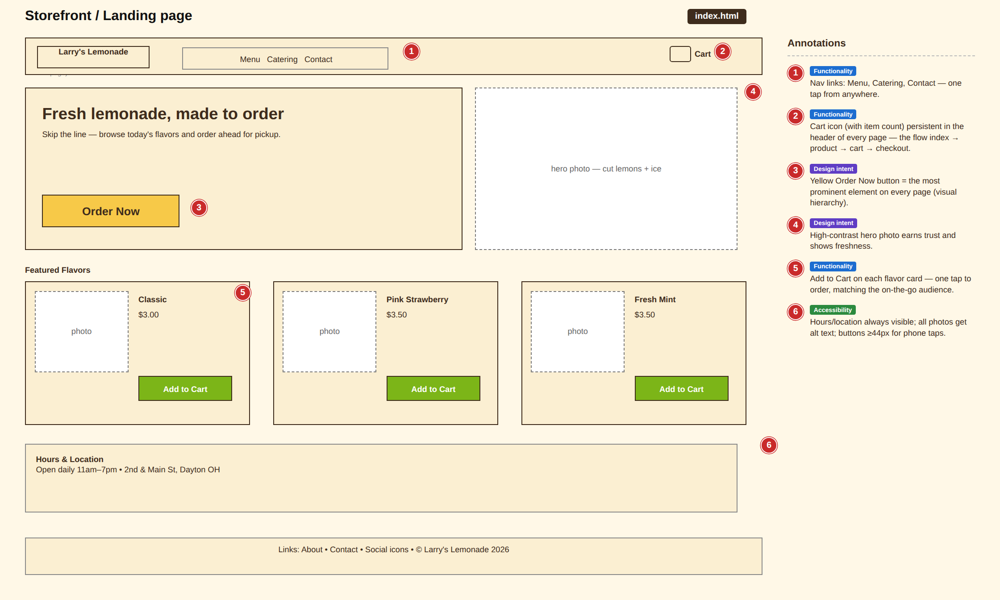
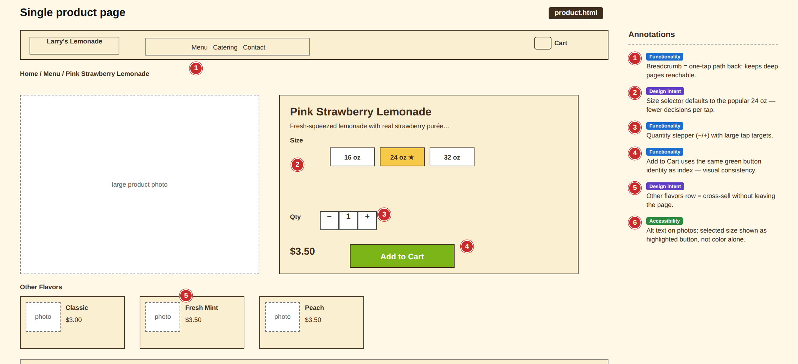
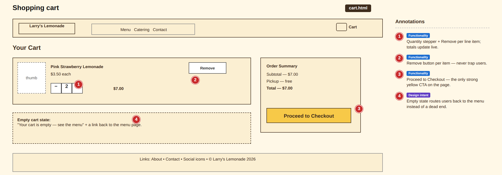
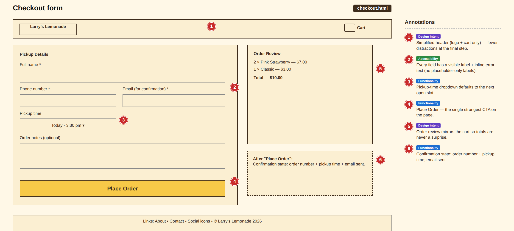

# Larry's Lemonade Stand 
# Storefront Website Story & Wireframes

**Student:** Shakhmamed Shakhmamedov
**Course:** CS 2800  Web Development 1
**Assignment:** Assignment 1
**Date:** October 2, 2026

## Part 1: The Story

### 1. Client Profile

Larry's runs a  Lemonade Stand in Dayton, OH and he sells lemonade every summer. Larry sells cups of freshly squeezed lemonade with multiple flavors like classic lemon, pink strawberry, and fresh mint flavors. The stand is very popular on hot days, but there are long lines of people and larry is limited by the hours he can work which mean lost revenue. The customers walk away when the line is too long and there is no way to order ahead. What Larry needs is a simple website so customers can browse the menu and order online for pickup.

### 2. Purpose & Goals

The main purpose of the site is to allow customers to browse the menu, see the hours that Larry is open, and place order-ahead pickup orders. 

The goal of the website is too:
- Boost sales
- Shorten the lines at the stand
- Get customers to buy from him in the future

The user experience supports these goals: the menu is one click on the homepage screen and a order of lemonade takes under 5 minutes from the home page to order confirmation screen.

### 3. Target Audience

The site's visitors are the local customers like families with kids or the students from high school and college. Pretty much anyone that likes lemonade is the audience. They mostly visit when they are craving a nice refresher and need it as soon as possible. They are friendly and patient customers but want there drinks fast. Their needs are simple: see which flavors are available and  see the prices and order fast. Because everyone mostly has access to their phone, they are able to visit larrys website and order from there.

Because users are on phones and in a rush  the website design will use large buttons, easy to read pages and  a bright tone for accesbiltiy reasons. 
### 4. User Story

A first time customer can search up “ larryslemonde.com “ and lands on the homepage. Or they can scan a QR code on Larrys Stand for easier access. The homepage shows today's flavors and a big "Order Now" button. The user can also tap on the Menu button at the top to see all the drinks that are able to be bought. Then the user can add any drinks they want to buy to the cart with a quick click. The cart page shows the items in the cart and total cost.. At checkout the user enters there name and payment information then picks a pickup time, and places the order. They will then gets a confirmation number and email and able to wait outside the line for there order to be ready Total time is under 5minutes.

### 5. Visual Direction

**Colors**

| Use | Color | Hex |
|---|---|---|
| Accents | Lemon yellow | `#F7C948` |
| Page background | Cream | `#FFF8E7` |
| Text | Dark brown | `#3E2C1C` |
| Buttons | Fresh green | `#7CB518` |

**Typography:** Rounded elements for a friendly feel. Open Sans for easy to read font on small screens.

**Imagery:** Bright, high-contrast photos like cut lemons and ice so the product feels cold and fresh.

 **Visual hierarchy:** the yellow accent with the "Order Now" button is the most prominent element on every page, so thec customers are easily directed to purchase.

 **Proximity:** each item on the menu is grouped up so the items picture, name, and price are together so the menu can be scanned quickly

**Accessibility:** dark brown text on yellow and cream backgrounds keeps contrast high. All product images get descriptive alt text, form fields have visible labels, and buttons are sized for easy phone taps.

---

## Part 2: Wireframes

Each shows layout the regions, interactive elements, and callouts explaining functionality, design intent, and accessibility choices. Navigation flow: index → product → cart → checkout, with a cart icon in the header of every page.

### Page 1 the `index.html` (Storefront / Landing Page)

**Annotations:**

1. **Functionality** — Nav links: Menu, Catering, Contact — one tap from anywhere.
2. **Functionality** — Cart icon (with item count) persistent in the header of every page — the flow index → product → cart → checkout.
3. **Design intent** — Yellow Order Now button is the most prominent element on every page (visual hierarchy).
4. **Design intent** — High-contrast hero photo earns trust and shows freshness.
5. **Functionality** — Add to Cart on each flavor card — one tap to order, matching the on-the-go audience.
6. **Accessibility** — Hours/location always visible; all photos get alt text; buttons are ≥44px for phone taps.

**Layout regions:**
- Header: logo left; navigation area in the middle (Menu, Catering, Contact) and cart icon right.
- Main page: yellow block with headline, tagline, "Order Now" button, hero photo
- Featured flavors: 3 cards of the flavors (Classic, Strawberry, Mint) with the photo, name, price, "Add to Cart"
- Info section: hours and location
- Footer: links, social icons, copyright

**Interactive elements:** nav links, "Order Now" button, per-item "Add to Cart" buttons, cart icon.

### Page 2 the `product.html` (Single Product)

**Annotations:**

1. **Functionality** — Breadcrumb = one-tap path back; keeps deep pages reachable.
2. **Design intent** — Size selector defaults to the popular 24 oz — fewer decisions per tap.
3. **Functionality** — Quantity stepper (−/+) with large tap targets.
4. **Functionality** — Add to Cart uses the same green button identity as the landing page — visual consistency.
5. **Design intent** — Other flavors row = cross-sell without leaving the page.
6. **Accessibility** — Alt text on photos; selected size is shown as a highlighted button, not color alone.

**Layout regions:**
- Header: same nav + cart icon
- Breadcrumb: Home / Menu / Strawberry Lemonade
- Product section, two columns: large photo left; details right (name, description, size options, price, quantity stepper, "Add to Cart")
- "Other flavors" row: 3 small cards
- Footer

**Interactive elements:** size selector, quantity stepper, "Add to Cart" button, breadcrumb links.

### Page 3 — `cart.html` (Cart)

**Annotations:**

1. **Functionality** — Quantity stepper + Remove per line item; totals update live.
2. **Functionality** — Remove button per item — never trap users.
3. **Functionality** — Proceed to Checkout — the only strong yellow CTA on the page.
4. **Design intent** — Empty state routes users back to the menu instead of a dead end.

**Layout regions:**
- Header: same nav + cart icon
- Page title: "Your Cart"
- Item list: thumbnail, name, unit price, quantity stepper, line total, Remove button per item
- Summary box: subtotal, total, "Proceed to Checkout" button
- Empty state: "Your cart is empty — see the menu" with a menu link
- Footer

**Interactive elements:** quantity steppers, Remove buttons, "Proceed to Checkout" button, menu link.

### Page 4 — `checkout.html` (Checkout)

**Annotations:**

1. **Design intent** — Simplified header (logo + cart only) — fewer distractions at the final step.
2. **Accessibility** — Every field has a visible label and inline error text (no placeholder-only labels).
3. **Functionality** — Pickup-time dropdown defaults to the next open slot.
4. **Functionality** — Place Order — the single strongest CTA on the page.
5. **Design intent** — Order review mirrors the cart so totals are never a surprise.
6. **Functionality** — Confirmation state: order number + pickup time; email sent.

**Layout regions:**
- Simplified header: logo + cart icon only (fewer distractions at the final step)
- Two columns: order form left (name, phone, email, pickup time dropdown, notes); order review right (items, quantities, total)
- "Place Order" button
- Confirmation state: order number + pickup time after submitting
- Footer

**Interactive elements:** text fields, pickup time dropdown, "Place Order" button.
